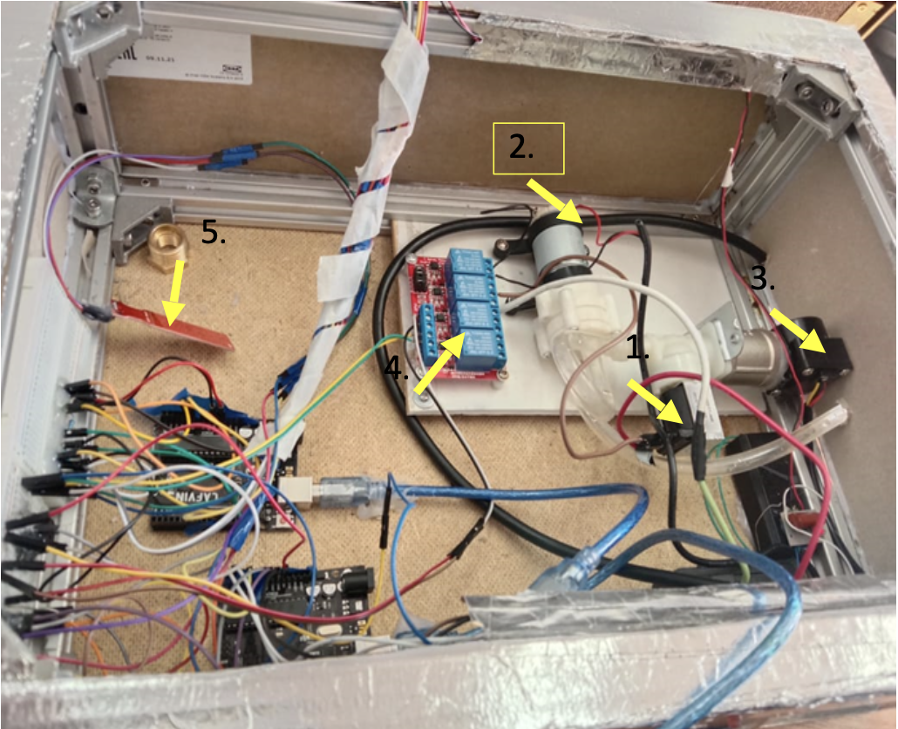
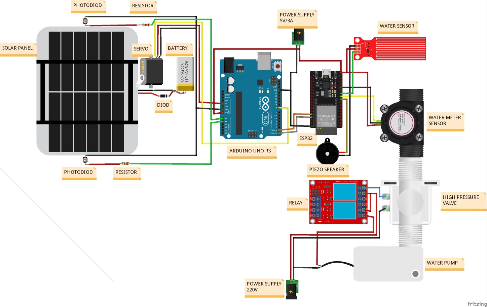
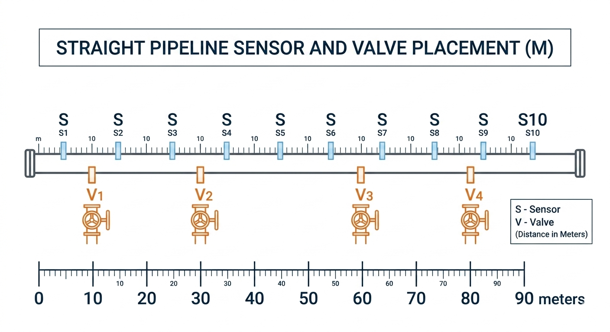

# NEW PIPE — Smart Pipeline Monitoring System

**Ayakoz Kanatnur | Engineering Research Portfolio**

**Research areas:** Arduino, Embedded Systems, Water Leak Detection, Smart Infrastructure, Predictive Maintenance

## Project Overview

NEW PIPE is an engineering research project focused on automated water leak monitoring and pipeline protection.

The project has evolved through two stages: an original Arduino-based physical prototype and a subsequent conceptual design for a more advanced intelligent pipeline monitoring system.

## 1. Original NEW PIPE — Arduino Prototype

The initial NEW PIPE project involved the construction and testing of a physical Arduino-based prototype for monitoring water leakage and supporting automated pipeline control.

This stage provided practical experience with electronic components, sensors, microcontroller-based control, and hardware integration.

## 2. Updated NEW PIPE — Proposed Intelligent Architecture

The updated design, presented at a conference, explores a more advanced smart pipeline system.

The proposed architecture includes:

- Arduino Uno and ESP32-based control and communication.
- Water flow, pressure, and moisture monitoring.
- Relay-controlled isolation valves.
- Solar-assisted power supply and battery storage.
- Potential Random Forest-based anomaly detection.
- Potential LSTM-based predictive maintenance.

The updated version is a conceptual engineering design supported by circuit and system diagrams. It has not been physically implemented or experimentally validated.

## Proposed Operation

The system is designed to collect sensor measurements, identify possible abnormal water-flow conditions, and trigger automatic valve isolation when predefined conditions indicate leakage.

Future development may integrate machine learning to identify anomalies and forecast infrastructure deterioration.

The term "self-healing" refers to proposed automated fault isolation, not physical repair of damaged pipes.

## Experimental Status and Limitations

The original Arduino prototype was physically assembled and tested.

The updated intelligent architecture has not undergone physical or field testing.

The proposed large-scale network dimensions, response times, water-loss reductions, and machine-learning capabilities are not validated experimental results.

No measured performance claims are made for the updated architecture.

## Project Development

Future work includes implementing the updated hardware design, collecting sensor data, testing valve-control logic, and evaluating machine-learning models under controlled experimental conditions.

## Research Documentation

This repository is intended to document available prototype materials, engineering diagrams, and the development of the NEW PIPE concept.

The original prototype and the proposed updated architecture are presented separately to distinguish completed implementation from future development.

## Project Figures

### 1. Original Arduino Prototype

Physical prototype assembled and tested during the initial NEW PIPE project.

### 2. Updated Conceptual Circuit Design

Proposed Arduino-based circuit architecture for the updated NEW PIPE system. This design has not yet been physically implemented or experimentally validated.

### 3. Proposed Pipeline Sensor and Valve Layout

Illustrative pipeline layout showing the proposed arrangement of sensors and isolation valves. This is a conceptual layout, not an implemented field installation.

